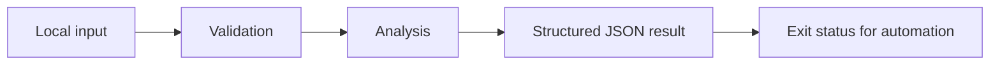

# Structured Log Redactor

Recursive JSON field redaction with JSON Lines streaming and fail-closed parsing.

A focused Python command-line project with synthetic examples, explicit behavior, and regression tests. It runs locally without credentials or third-party packages.

## Run it

Requires Python 3.11 or newer.

```sh
python3 redact.py sample.jsonl
python3 -m unittest -v
```

See [VALIDATION.md](VALIDATION.md) for the actual local test output and example result. GitHub Actions runs the suite on Python 3.11, 3.12, and 3.13.

## Design

The redactor walks dictionaries and arrays, replacing values under configured keys. Matching is exact and case-insensitive. A JSON Lines stream is processed one record at a time. Invalid JSON stops processing without echoing that line. Earlier redacted records may already have reached stdout. Additional --key arguments extend the default key set.



## Scope and limitations

This is field-name redaction, not comprehensive secret detection. Free-text messages, key names, URLs, and unconfigured aliases can contain sensitive content that this tool does not remove. Never treat its output as safe for public release without reviewing the source schema and output. No external data is uploaded.

## Project layout

- `redact.py`: core functions and command-line entry point.
- `test_redact.py`: behavioral tests, including invalid inputs and boundary cases.
- `sample.json`: fictional example input or example notes.
- `VALIDATION.md`: reproducible local validation record.
- `.github/workflows/tests.yml`: automated tests with read-only repository permissions.

The core functions can be imported independently of the command line. Input files are never modified. Sample data is synthetic; the repository does not claim production usage or customer results.

MIT licensed.
